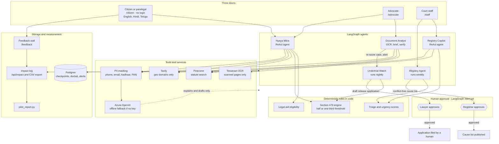

# NyayaVedika (న్యాయవేదిక): agentic AI for timely justice

**Track:** Timely Justice, Legal Backlog (Code for a Billion, impact area 07)
**Live demo:** DEMO_LINK_HERE · **Demo video (2–3 min):** VIDEO_LINK_HERE · **AgentFoundry project:** AF_PROJECT_LINK_HERE · **Licence:** MIT

India's law already says when many undertrial prisoners must be released. What is missing is someone, or something, that notices the date, prepares the paperwork and puts the decision in front of a human on time. NyayaVedika is a set of AI agents and a lawyer workbench that does that noticing and preparing. **A human approves every step that has legal consequences.**

Every figure below is tagged **Reported** (published by the named source), **Derived** (our arithmetic on reported figures) or **Estimate** (our model, assumptions stated). Each carries its date.

---

## 1. Size of the problem: how many people face it

| Population | Figure | Source and date | Type |
|---|---|---|---|
| People waiting on a court | **5.64 crore pending cases**: district and subordinate courts 4.98 crore, High Courts about 64 lakh, Supreme Court about 96,000 | Law Ministry reply, Rajya Sabha, 23 July 2026 (NJDG data as of 16 July 2026) | Reported |
| Pendency six months earlier | 5.39 crore at 31 December 2025 | Law Ministry reply, Lok Sabha, 13 February 2026 | Reported |
| Cases pending for decades | 81,275 district-court cases and about 80,600 High Court cases are over 30 years old | Rajya Sabha reply, July 2026 | Reported |
| People in jail without a conviction | **4,03,302 of 5,31,949 prisoners (75.81%)**, October 2025 | NALSA, UTRC report Oct–Dec 2025 | Reported |
| People entitled to free legal aid | **About 80% of the population**, which is more than 110 crore people | India Justice Report 2025 (share); our arithmetic on a population of about 1.4 billion | Reported / Derived |

Every pending case has at least two parties, plus families and witnesses, so the number of people affected is larger than the case count. One person can be in several cases, so we claim no exact number of people. "Entitled" means eligible by law, not in need in a given year. The live [National Judicial Data Grid](https://njdg.ecourts.gov.in/) dashboard updates daily and is the reference for today's count.

## 2. Severity: the human suffering, the economic loss and how the harm ripples

### Human suffering

- **Long detention without conviction.** Of 3,89,910 undertrials at the end of 2023, **1,19,654 had been held over one year, 64,999 over two years, 33,398 over three years and 10,392 over five years** (NCRB, Prison Statistics India 2023). At the end of 2024, nearly 30,000 (8.1%) had been held over three years (PSI 2024).
- **Overcrowding.** 5,30,333 prisoners in space for 4,39,119: **120.8% occupancy** at the end of 2023 (PSI 2023). It was 112.7% in 2024 (PSI 2024).
- **A legal remedy exists and is not reaching enough people.** Section 479 of the Bharatiya Nagarik Suraksha Sanhita (BNSS) requires release after half the maximum sentence, or one-third for first-time offenders. In the October to December 2025 quarter, the review committees (UTRCs) across the country identified **14,387 prisoners for review, recommended 10,754, saw 9,011 applications filed and 5,864 released** (55% of those recommended). Only 2.7% of all prisoners were identified for review (NALSA).

| Category (NALSA Q4 2025) | Identified | Recommended | Applications filed | Released |
|---|---|---|---|---|
| Section 479, half-sentence | 209 | 175 | 164 | 96 |
| Section 479, first-time offender, one-third | 279 | 255 | 250 | 209 |
| Bail granted but surety not furnished | 4,345 | 3,455 | 3,085 | 1,936 |
| Women undertrials | 2,885 | 1,416 | 1,234 | 514 |
| All 16 categories | 14,387 | 10,754 | 9,011 | 5,864 |

- **The gap between a recommendation and release.** 1,946 filed applications were still pending when the data was reported, and 834 had bail refused. State outcomes differ sharply: Maharashtra recommended 1,470 and released 255 (17%); Telangana recommended 554, filed 314 and released 140 (25%); Andhra Pradesh recommended 184 and released 98 (53%).
- **Only 488 people were identified under the two Section 479 categories nationally in one quarter** (209 + 279), while 64,999 undertrials had been held over two years at the end of 2023. The two figures are from different dates, and not every long-held person is eligible, so the gap cannot be stated exactly. It is the reason identification is the first target.
- **Most people cannot reach a lawyer.** Free legal aid and advice reached 16,60,249 people in FY 2025-26 up to January 2026 (Law Ministry, Lok Sabha, 13 March 2026), about 0.15% of those entitled (Derived). Public spending on legal aid is about ₹6.46 per person a year (India Justice Report 2025). Only 7.91% of undertrials used free legal aid in 2016–19 (Surendranath and Andrew 2022, NCRB admission data).
- **Once a case is recommended, representation is near-universal.** Of 10,754 recommended, 5,963 had a private lawyer, 4,730 a legal-aid lawyer and 16 none (NALSA). The weak points are identification, filing in some states, pending applications and release, which is where NyayaVedika works.
- **Where a defence lawyer is assigned, release follows.** Under the Legal Aid Defence Counsel scheme, 2,76,476 undertrials were represented and 59,630 released in FY 2025-26 up to December 2025 (Law Ministry). The scheme's counts use different definitions from the committee data, so we do not add them together.

### Economic loss

| Loss | Figure | Source and date | Type |
|---|---|---|---|
| Litigants' lost wages and business income from attending hearings | **₹50,387 crore a year, 0.48% of GDP** | DAKSH Access to Justice Survey, 9,329 litigants, conducted 2015–16 | Reported |
| Litigants' cost of attending hearings | About ₹30,000 crore a year | Same survey | Reported |
| Direct spend on prison inmates | **₹2,669.88 crore in FY 2023–24**, about ₹4,195 per inmate per month on 5,30,333 prisoners | NCRB, expenses on inmates 2023–24; our division | Reported / Derived |
| Total prison expenditure | ₹8,834.6 crore actually spent in FY 2023–24 | PSI 2023 | Reported |

The DAKSH survey is ten years old, so today's loss is likely higher. We have not scaled it.

**Our estimate of avoidable custody (assumption-based, not a published figure).** The 1,19,654 undertrials held over a year is the upper bound on who could be eligible. Excluding offences punishable by death or life and people with other pending cases gives the range below.

| Scenario | Detention pool | Excluded as ineligible | Eligible people | Delay | Direct custody cost |
|---|---|---|---|---|---|
| Conservative | 33,398 (over 3 years) | 45% death or life offences, then 40% other cases | 11,021 | 3 months | ₹13.9 crore |
| Central | 64,999 (over 2 years) | 35% death or life offences, then 30% other cases | 29,575 | 6 months | ₹74.4 crore |
| Progressive | 1,19,654 (over 1 year) | 25% death or life offences, then 20% other cases | 71,792 | 12 months | ₹361.4 crore |

Eligible people = pool × (1 − excluded share for death or life offences) × (1 − share with other cases). Direct custody cost = eligible people × months of delay × ₹4,195. **The excluded shares and the delay are our assumptions.** The cost covers only the average direct inmate spend, not lost wages, lost jobs or family costs. A pilot with real custody records will replace these assumptions.

### How the harm ripples outward

A missed release does not stay with one person. The cost travels in four stages, and each stage is a point where the chain can be cut.

| Stage | What happens | Evidence | Where it can be cut |
|---|---|---|---|
| 1. Trigger | A person crosses the half or one-third threshold and nobody checks the date. Identification relies on manual ledger audits and quarterly committee sittings | NALSA Q4 2025: 209 identified under the half-sentence category in one quarter | Automated nightly threshold check |
| 2. Direct harm | Continued custody without conviction | NALSA Q4 2025: 14,387 identified, 5,864 released (55% of 10,754 recommended) | A ready, reasoned application and a named reviewer |
| 3. First-order spread | The household loses its earner, borrows for lawyers and travel, and may pull children out of school. The state keeps paying about ₹4,195 a month per inmate | NCRB spend (Derived); household effects are mechanism only | Earlier release and earlier counsel |
| 4. System feedback | Overcrowding, less capacity for fair treatment, more adjournments, more pending cases | 120.8% occupancy in 2023 and 112.7% in 2024 (NCRB); over 5.6 crore pending (NJDG) | Cleaner listing and complete case papers |

Two features make the chain **self-reinforcing**. First, the people who are not identified are the ones least able to reach a lawyer on their own: only 7.91% of undertrials used free legal aid in 2016–19. Second, each missed release adds to overcrowding, which makes the next review harder.

| Who bears the ripple | How it spreads | Measured evidence | Not yet quantified |
|---|---|---|---|
| **Households** | Loss of earner income, informal debt, school withdrawal | The DAKSH survey shows litigants lose ₹50,387 crore a year in wages and business income across all case types (2015–16) | Income loss and debt per undertrial; effect on school dropout |
| **Women and their dependants** | Women carry the burden of the household, and a jailed woman's dependants lose their carer | 1,049 women undertrials at the end of 2023 (NCRB). The Supreme Court directed on 19 November 2024 that eligible women prisoners be identified. In Q4 2025, 514 of 1,416 recommended women were released (NALSA) | Effect on dependants of jailed women |
| **Society** | Unequal access to the law, and loss of trust when a legal right does not reach those who need it | A quarter of prisoners are uneducated and over 40% are below Class X (PSI 2023). Legal aid reached about 0.15% of those entitled in a year (Derived). A cash-bail scheme had ₹20 crore outlay, ₹28.67 lakh used and 144 prisoners helped | Public trust (no survey exists); whether low literacy changes bail outcomes |
| **Prisons and courts** | Overcrowding, adjournments and a growing backlog | 75.81% of inmates are undertrials. Over 5.6 crore cases are pending, about 64 lakh for over ten years. Adjournments and summons took about 54% of civil and 33% of criminal sitting time in a four-court study (DAKSH 2016) | Share of adjournments caused by missing papers or advocate clashes; share of overcrowding caused by eligible people still held (our estimate: tens of thousands) |
| **Economy** | Lost earnings, hearing costs and state custody spend | ₹50,387 crore a year of litigant loss and about ₹30,000 crore a year to attend hearings (2015–16); ₹2,669.88 crore direct spend on inmates in FY 2023–24 | Update to current prices; full institutional cost per inmate |

The pattern in the last column is itself a finding. The largest costs, to households and to public trust, are the least measured. We therefore put **no number on the ripples** beyond the direct custody floor above. Avoidable custody is also a small part of the ₹50,387 crore litigant loss, so our claim is a targeted contribution to one part of that loss, not a fix for all of it. A pilot that records household outcomes after release (income resumed, debt taken, children back in school) would add more to the evidence than another national statistic. Section 4 has the slots for it.

## 3. Quality of the solution

### What we built

Every legal rule (eligibility, Section 479 thresholds, urgency scores) is **deterministic code that shows its reasons**. The language model chooses tools, reads documents, explains results and drafts documents. It never decides eligibility.

| Agent | What it does | Human gate |
|---|---|---|
| **Undertrial Watch** (runs nightly) | Scans custody cases, computes the Section 479 threshold, itemises the arithmetic, drafts the release application | A lawyer approves before anything is filed |
| **Nyaya Mitra** (ReAct agent) | Checks free legal-aid eligibility, calculates Section 479 release, searches statutes (Pinecone) and official government sites (Tavily), asks clarifying questions when facts are missing | Pauses to ask the person |
| **Document Analyst** | OCRs only the scanned pages, writes a case brief, then verifies it. Every date and statute must appear in the source, and unsupported claims are rewritten (up to two repair rounds) | Output is reviewed by a lawyer |
| **Registry Agent and Copilot** | Triage the whole docket with reasons, build a conflict-free cause list sized by adjournment risk | A registrar approves before publishing |



**Three doors:** `/citizen` for citizens (no login; English, Hindi and Telugu), `/advocate` for lawyers, `/staff` for court staff. A public feedback wall for field responses is at `/feedback`.

**Advocate workbench** (private, lawyer-only, nothing added to court records):
- *Document Studio:* merge, split into volumes, reorder, rotate, remove pages, OCR text export, bookmarks, a clickable index and page numbers.
- *AI Document Insights:* Issues, Facts, Case Background and Summary for a PDF. Every point carries a page number and a verbatim excerpt, and inferences are labelled as inferences.

### Why the design works

- **Rules in code, not model output.** The Section 479 check (`nyayavedika/triage.py`) returns `eligible`, `likely_eligible`, `needs_review` or `not_eligible`, and every status still goes to a lawyer. Worked example: for an offence with a three-year maximum, a first-time offender becomes eligible after one year and others after eighteen months. The agent computes the date from the remand date, shows the figures and drafts the application.
- **It targets the measured gap.** NALSA's own report shows the weak points are identification (2.7% of prisoners), filing in some states, 1,946 pending applications and surety-blocked release. Undertrial Watch lists, itemises and drafts for exactly these.
- **Human approval at every consequential step.** Approval uses LangGraph `interrupt()`. Checkpoints live in Postgres, so a paused case survives a restart.
- **Grounded outputs.** Briefs are verified against the source. Insights require a page number and an excerpt.
- **Privacy.** Phone, email, Aadhaar and PAN numbers are masked before text reaches any model, vector index or web search. Web search is limited to official legal and government domains. Advocate workspaces use random server-validated tokens stored only as SHA-256 hashes.
- **Works without keys.** With no API key the app runs offline on rules.
- **Measurable by design.** `/api/impact` and `/api/impact/export.csv` aggregate events from every agent, and `scripts/pilot_report.py` builds a pilot table from a per-case log.

### How we used AgentFoundry (AF)

AF_SECTION_HERE

### Tests and checks

The Section 479 engine is pinned by 21 hand-derived cases in `tests/gold_479.json`. They are **not yet verified by a lawyer**. Run the offline suite, which needs no keys, with `python -m unittest discover -s tests`, and the synthetic evaluation with `python scripts/eval_demo.py`. Those results describe invented cases and invented courts, so they show the system behaves as designed, not how a real court performs. They are not evidence of field impact.

### Known limits

- Triage points, income limits and the statutes table (46 rows of demo data) need lawyer review. The demo uses static role tokens, not real authentication.
- The release check works from docket fields and cannot see cases outside the docket, so a lawyer confirms before filing.
- Names and addresses are not masked. Do not upload real case files to a hosted model without consent.
- Prison and court records are fragmented. The system uses bulk imports and OCR of scanned remand sheets rather than a live e-Prisons link.
- Poverty can still block release when a court has ordered it, for example when no surety can be found.
- Outputs are legal information for a lawyer to review, not legal advice. Nothing is filed without a human decision.

## 4. Proven impact

<!-- Add real deployment data here. Keep pilot numbers separate from the synthetic checks above. -->

**Pilot setting:** _TO BE ADDED_ (who used it, where, over what period)

| Indicator | Before | After / result |
|---|---|---|
| People screened | | |
| Eligible people found that had not been listed | | |
| Days from eligibility to application / to release | | |
| Applications filed | | |
| Releases secured | | |
| Custody days avoided | | |
| Legal-aid applicants reached | | |
| Advocate hours saved per case | | |
| Household: income resumed after release (consented follow-up) | | |
| Household: debt taken during custody | | |
| Household: children back in school | | |
| Adjournments caused by missing papers or clashes | | |

**Field feedback:** _TO BE ADDED_ (aggregates from the public feedback wall: responses, average rating, share whose situation changed)

---

## Run it

```bash
pip install -r requirements.txt     # Python 3.12
cp .env.example .env                # set distinct long random DEMO_TOKEN_* values
python scripts/reset_demo.py        # seeds synthetic data
python server.py                    # http://127.0.0.1:8000
python -m unittest discover -s tests
```

Open `/citizen`, `/advocate` or `/staff`. With no keys the app runs offline. Add `AZURE_OPENAI_*`, `PINECONE_API_KEY` and `TAVILY_API_KEY` to `.env` to switch on the LLM, vector search and web search. Scanned pages need Tesseract with language packs (for example `apt install tesseract-ocr tesseract-ocr-hin tesseract-ocr-tel`). `docker compose up --build` runs the full stack. The template's income thresholds and triage weights are placeholders, so set the applicable state values before relying on eligibility results. Set `DEMO_MODE=false` and use real authentication before any deployment with real data.

## Sources

- [NALSA, Functioning of the Under Trial Review Committees, October to December 2025](https://cdnbbsr.s3waas.gov.in/s32e45f93088c7db59767efef516b306aa/uploads/2026/02/20260211666479586.pdf)
- [NCRB, Prison Statistics India 2023](https://www.ncrb.mha.gov.in/uploads/files/PSI-2023.pdf)
- [The News Minute / IndiaSpend on Prison Statistics India 2024](https://www.thenewsminute.com/news/dataviz-who-are-indias-371000-prisoners-awaiting-trial)
- [NCRB expenses on inmates by year (via Dataful)](https://dataful.in/datasets/23017)
- [DAKSH Access to Justice Survey, key findings](https://dakshindia.org/state-of-the-indian-judiciary/28-chapter-15.html)
- [Law Ministry reply on legal aid and LADCS, Lok Sabha, 13 March 2026 (reported by ANI)](https://newsable.asianetnews.com/india/over-166-lakh-get-free-legal-aid-in-fy-202526-law-ministry-articleshow-rsh2lwr)
- [India Justice Report 2025, national press release](https://indiajusticereport.org/files/English_National%20Press%20Release_India%20Justice%20Report%202025.docx05e1a2.pdf)
- [Bar & Bench: India's legal aid crisis, what the data really shows](https://www.barandbench.com/amp/story/columns/indias-legal-aid-crisis-what-the-data-really-shows)
- [Bar & Bench: Rajya Sabha reply on pendency, July 2026](https://www.barandbench.com/news/26-cases-pending-in-supreme-court-for-30-years-558-cases-for-20-years-centre-in-rajya-sabha)
- [Telangana Today / PTI: 5.64 crore cases pending, Rajya Sabha, 23 July 2026](https://telanganatoday.com/more-than-5-64-crore-cases-pending-across-indian-courts-rs)
- [Law Ministry reply, Lok Sabha, 13 February 2026: 5.39 crore pending (via Moneylife)](https://www.moneylife.in/article/court-case-pendency-rises-to-539-crore-supreme-court-sees-11-percentage-jump-in-one-year-govt/79667.html)
- [National Judicial Data Grid](https://njdg.ecourts.gov.in/)
- [ThePrint on Prison Statistics India 2023](https://theprint.in/india/drop-in-inmates-additions-but-indian-prisons-120-full-delhi-jails-most-overcrowded-at-200-ncrb-data/2754893)
- [Verdictum: Supreme Court order of 19 November 2024 on prolonged incarceration of undertrials](https://www.verdictum.in/court-updates/supreme-court/in-re-inhuman-conditions-in-1382-prisons-release-undertrial-prisoners-prolonged-incarceration-1559091)
- [Millennium Post: Section 479 releases](https://www.millenniumpost.in/nation/govt-over-330-undertrial-prisoners-released-on-bail-under-bnss-section-479-604985)

## Licence

Open source under the [MIT licence](LICENSE). Built for the Code for a Billion hackathon by Code for India.