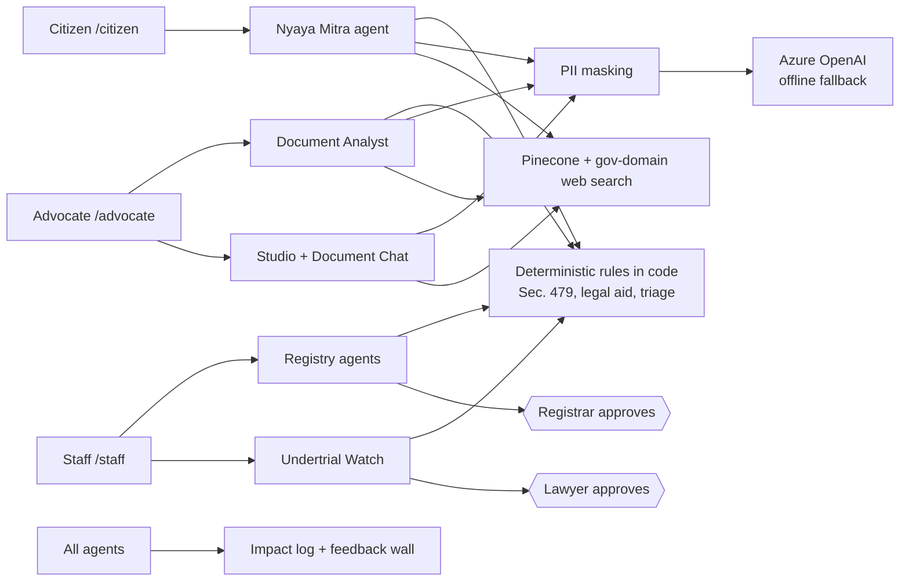

# NyayaVedika (న్యాయవేదిక): agentic AI for timely justice

**Track:** Timely Justice, Legal Backlog (Code for a Billion, impact area 07)
**Live demo:** [NYAYAVEDIKA](https://nyayavedika.delightfulmushroom-95327f3a.koreacentral.azurecontainerapps.io/) · **Demo video (3 min):** https://youtu.be/D3xo-yJMhwg · **Licence:** MIT
**Live impact dashboard:** [Metrics](https://nyayavedika.delightfulmushroom-95327f3a.koreacentral.azurecontainerapps.io/metrics) · **Detailed evidence and research:** [docs/RESEARCH_EVIDENCE.md](docs/RESEARCH_EVIDENCE.md)

This repository now includes the full three-door product set: citizen legal-aid / problem-research flows, advocate document studio and grounded insight tools, and staff intake / triage / cause-list / undertrial-watch workflows. It also includes public impact metrics, a consent-based feedback wall, worker-driven ingestion and offline-safe fallback modes.

Latest updates reflected in this branch:
- public metrics page and aggregate activity API
- feedback wall with outcome/time-saved reporting
- legal-aid knowledge-base, draft application and explain flows
- staff intake, docket, cause-list, alerts and review gates
- advocate workspace isolation, studio tooling and page-grounded chat
- offline-compatible rules engine and deterministic fallback behavior

Figures are tagged **Measured** (our product logs), **Reported** (published by the named source), **Derived** (our arithmetic on reported or measured figures) or **Estimate** (our model, assumptions stated).

---

## Problem statement

India's law already says when many undertrial prisoners must be released. Section 479 of the Bharatiya Nagarik Suraksha Sanhita (BNSS) requires release after half the maximum sentence, or one-third for first-time offenders. What is missing is someone, or something, that **notices the date, prepares the paperwork and puts the decision in front of a human on time**.

Three groups fall through the same gap:
- **People in custody and their families**, who cannot find or afford a lawyer and do not know they may be eligible for release or free legal aid.
- **Advocates**, who lose hours assembling, paginating and reading very long case papers before a hearing can be useful.
- **Courts and registries**, where triage, scheduling clashes and incomplete papers feed adjournments and a growing backlog.

### Why all three doors, not one

The backlog is a chain, and it breaks at a different link for each group. A citizen who does not know they qualify for legal aid never reaches a lawyer. A lawyer who cannot read or assemble the record in time cannot make a hearing useful. A registry that cannot see which cases are urgent lists the wrong matters. Fixing one link only moves the bottleneck to the next. NyayaVedika therefore equips **citizens, advocates and court staff together**, on the same deterministic rules (Section 479, legal-aid eligibility, triage) and the same audit trail, so what one door produces is something the next door can act on. The current repository already shares the rules, data model and audit trail across the three doors, and the system is designed so the same event stream can support a future single-case supervisor layer without forcing a rewrite of the working product.

## What we built

NyayaVedika is a set of AI agents and a lawyer workbench with three doors. Every legal rule (eligibility, Section 479 thresholds, urgency scores) is **deterministic code that shows its reasons**. The language model chooses tools, reads documents, explains and drafts. It never decides eligibility. **A human approves every step that has legal consequences.**

**How the track's four focus areas map to the three doors.** Each focus area is served at every level, not by one door alone.

| Track focus | Citizen | Advocate | Court staff |
|---|---|---|---|
| **Case triage** | Understand a legal problem sorts a situation into a category and points to the right law and office | Insights surface the issues and facts in a file | Priority scores with reasons; Undertrial Watch flags Section 479 cases |
| **Document summarisation** | Understand a court document gives a plain-language brief | Insights and page-cited chat on the lawyer's own file | Intake summaries and field extraction, verified against the source |
| **Legal aid access** | Eligibility check and a drafted application | Insights give a lawyer the facts and issues for a legal-aid or release application | Alerts for people held past the Section 479 threshold, with a drafted application for a lawyer to approve |
| **Scheduling efficiency** | Knowing what an order says and what to do next | Studio produces paper-books that are ready on time | Conflict-free cause list sized by adjournment risk |

| Door | Feature | What it does | What it eases | How impact is measured |
|---|---|---|---|---|
| **Citizen** `/citizen` (no login; English, Hindi, Telugu) | Free legal aid check | 5 questions, then an AI explanation and a drafted application | The legal-aid reach gap (about 0.15% of those entitled) | Checks, eligible, applications, partner-reported outcomes |
| | Understand a legal problem | Searches statutes and official government sites; asks for missing facts | Not knowing which law or office applies | Citizen sessions |
| | Understand a court document | Plain-language brief of an order or notice | Being unable to read what the court sent | Documents analysed |
| | Know your rights | Rights guidance, including for someone in custody | Families who do not know what to ask for | Citizen sessions |
| **Advocate** `/advocate` (lawyer token) | Document Studio | Merge, split into volumes, reorder, rotate, remove pages, OCR, bookmarks, clickable index, page numbers, all in memory | Hand-assembling paper-books in several desktop tools | Pages and operations per session |
| | AI Document Insights | Issues, Facts, Background or Summary of a PDF, DOCX, text or image (up to 50 pages). Every point has a page number and a verbatim excerpt checked against the text | Hours of reading; unverifiable AI claims | Documents analysed, upload-to-result time |
| | Chat with this document | Page-cited answers from the lawyer's own document only | Hunting through a file for one fact | Questions per session |
| **Court staff** `/staff` | Intake and Docket | Reads case files and scores every pending case, with reasons | Manual sorting of the docket | Cases triaged |
| | Cause list | Conflict-free weekly hearing list sized by adjournment risk; registrar approves | Clashes and adjourned hearings | Cases listed, conflicts avoided, critical wait gained |
| | **Undertrial Watch** (nightly) | Computes the Section 479 threshold, itemises the arithmetic, drafts the release application; lawyer approves | Eligible people missed because nobody checked the date | People flagged, applications approved, custody days over the limit |
| | Document summary, ADR routing, Insights tab | Briefs any document; routes suitable cases to Lok Adalat; weekly docket health | Reading time; cases that need not go to trial | Documents analysed, ADR candidates |
| **All** | Feedback wall `/feedback` | Public ratings and notes from field users | Early activity and self-reported feedback; legal outcomes are not independently verified | Responses, average rating, share whose situation changed |



**Why the design works**
- **Rules in code, not model output.** `nyayavedika/triage.py` returns `eligible`, `likely_eligible`, `needs_review` or `not_eligible`, and every status goes to a lawyer. For a three-year maximum offence, a first-time offender is eligible after one year and others after eighteen months.
- **It targets the measured gap.** NALSA's own report shows the weak points are identification, filing in some states, pending applications and surety-blocked release. Undertrial Watch lists, itemises and drafts for exactly these.
- **Human approval at every consequential step**, using LangGraph `interrupt()` with Postgres checkpoints, so a paused case survives a restart.
- **Grounded outputs.** Briefs are verified against the source. Insights need a page and a checked excerpt. Chat cites a page for every statement.
- **Privacy.** Phone, email, Aadhaar and PAN numbers are masked before text reaches any model, index or web search. Web search is limited to official domains. Advocate workspaces use random tokens stored only as SHA-256 hashes.
- **Works without keys.** With no API key the app runs offline on rules.

## How we used AgentFoundry (AF)

NyayaVedika was built in **AgentFoundry (AF)**, the official agentic IDE for Code for a Billion. The project was created in AF, the collaborators were invited into it, and the work ran on the free smart-code tokens every participant receives.

| Stage | How AF was used |
|---|---|
| **Scaffolding** | Generating the FastAPI server, the three static doors (`/citizen`, `/advocate`, `/staff`) and the SQLAlchemy data model |
| **Agents** | Building and iterating the four LangGraph agents (Nyaya Mitra, Document Analyst, Undertrial Watch, Registry), including their `interrupt()` human-approval pauses |
| **Rules and drafting** | Writing the deterministic Section 479, legal-aid and triage engines, and the cause-list planner |
| **Testing** | Writing and running the offline test suite (about 30 files) until it passed |
| **Documentation** | Drafting this README, `HOW_IT_WORKS.md` and `docs/RESEARCH_EVIDENCE.md` |


## Scale & severity of the problem

### Scale

| Population | Figure | Source and date | Type |
|---|---|---|---|
| People waiting on a court | **5.64 crore pending cases** (district 4.98 crore, High Courts about 64 lakh, Supreme Court about 96,000) | Law Ministry, Rajya Sabha, 23 July 2026 | Reported |
| People in jail without a conviction | **4,03,302 of 5,31,949 prisoners (75.81%)**, October 2025 | NALSA, UTRC report Oct–Dec 2025 | Reported |
| People entitled to free legal aid | **About 80% of the population**, over 110 crore people | India Justice Report 2025; our arithmetic | Reported / Derived |

Every case has at least two parties, plus families and witnesses, so the people affected exceed the case count. One person can be in several cases, so we claim no exact number of people.

### Severity

- **Long detention without conviction.** Of 3,89,910 undertrials at the end of 2023, **1,19,654 had been held over a year, 64,999 over two years and 10,392 over five** (NCRB). Prisons were at **120.8% occupancy** (Reported).
- **The remedy is not reaching enough people.** In Oct–Dec 2025 the review committees **identified 14,387 prisoners, recommended 10,754, saw 9,011 applications filed and 5,864 released**. Only 2.7% of prisoners were identified (NALSA, Reported). Release rates differ by state: Maharashtra 17%, Telangana 25%, Andhra Pradesh 53% of those recommended (Derived).
- **Few people reach a lawyer.** Free legal aid reached 16,60,249 people in FY 2025-26 up to January 2026, about **0.15%** of those entitled (Derived).
- **Economic loss.** Litigants lose **₹50,387 crore a year** in wages and business income (0.48% of GDP; DAKSH, 2015–16, Reported). The state spends about **₹4,195 per inmate per month** (NCRB ₹2,669.88 crore in FY 2023–24; Derived).
- **Our estimate of avoidable custody** (Estimate): between **11,021 and 71,792 people** eligible but still held, about **₹13.9 crore to ₹361.4 crore** in direct custody cost, with ₹74.4 crore as the central case. Method and assumptions are in the evidence file.

### How the harm ripples

| Stage | What happens | Where NyayaVedika cuts the chain |
|---|---|---|
| 1. Trigger | A person crosses the half or one-third threshold and nobody checks the date | Nightly automated threshold check |
| 2. Direct harm | Continued custody without conviction; only 55% of those recommended were released | A ready, reasoned application and a named reviewer |
| 3. Spread | The household loses its earner, borrows for lawyers and travel, children may leave school; the state keeps paying | Earlier release and earlier counsel |
| 4. System feedback | Overcrowding, more adjournments, a larger backlog | Cleaner listing and complete case papers |

The cycle reinforces itself. The people not identified are the least able to find a lawyer (only 7.91% of undertrials used free legal aid in 2016–19), and each missed release adds to the overcrowding that makes the next review harder. The largest costs, to households and public trust, are also the least measured, so **we put no number on the ripples** beyond the custody floor above. Full evidence tables are in [docs/RESEARCH_EVIDENCE.md](docs/RESEARCH_EVIDENCE.md).

## Proven impact

**Status:** NyayaVedika is live and in early field use. The figures below are a measured product-activity snapshot, not a claim of verified legal outcomes. The [public metrics dashboard](https://nyayavedika.delightfulmushroom-95327f3a.koreacentral.azurecontainerapps.io/metrics) is the live source; see [docs/RESEARCH_EVIDENCE.md](docs/RESEARCH_EVIDENCE.md) for definitions, caveats and the full evidence.

### Reach and use (Measured)

| Measure | Snapshot |
|---|---:|
| Distinct browsers, all activity | **49** (44 public-site browsers) |
| Portal visits | **111** (Citizen 32, Advocate 27, Staff 52) |
| Distinct browsers per door | Citizen 18, Advocate 13, Staff 11 |
| Browsers that used an API feature | **17** |
| Tool requests | **374** (Citizen 39, Advocate 41, Staff 293, one role unresolved) |
| Voluntary feedback responses | **7** |

Staff-door request volume includes reviewer activity, not just ordinary product usage.

| Product activity | Measured total |
|---|---:|
| Citizen sessions / completed five-question legal-aid checks | 51 / **50** |
| Draft legal-aid applications | **23** (46% of checks; Derived) |
| Court documents analysed | **7** |
| Undertrials flagged by Undertrial Watch | **23** |
| Release applications approved by a lawyer | **1** |
| Cases triaged by the registry agent | **607** |
| Cause lists published / cases scheduled | **3 / 1,209** |

The case-triage and scheduling totals include synthetic demo data as well as uploaded cases. An approved application is not evidence that a person was released. Drafts are not filed applications.

### Reliability, speed and feedback (Measured / Reported)

- **367 of 374 tool requests succeeded (98.1%, Derived).** The seven logged failures were in Undertrial Watch; they were attributed to internal code testing and have since been fixed. Other features had no logged failures in this snapshot.
- Typical server latency ranged from 0.08 seconds for case intake to about 32 seconds for document summaries. These are small per-feature samples (1–71 requests), not end-to-end task times or benchmarks.
- Seven voluntary feedback responses averaged **4.9/5**. Excluding one team member, six external responses (three lawyers, one advocate and two citizens) averaged **4.8/5**. This feedback is self-reported and the sample is small.

### Estimated time and cost effects (Estimate, not field measurements)

Measured server processing times suggest where work may be shortened, but the manual baselines and human-review times below are assumptions, not observed comparisons:

| Task | Estimated time saved |
|---|---:|
| Read a 40-page file and list issues/facts | About **25–70 minutes** |
| Brief a long document | About **15–55 minutes** |
| Assemble a paper-book | About **40 minutes–2.5 hours** |
| Check Section 479 eligibility for 50 undertrials | About **2.5–6.5 hours** |

At the derived direct custody cost of about **₹4,195 per inmate per month**, 100 people released three months earlier would correspond to about **₹12.6 lakh** in avoided direct custody cost. This is a formula, not a realized saving; one release application has been approved to date, and no release outcome is claimed. Full assumptions and calculations are in [docs/RESEARCH_EVIDENCE.md](docs/RESEARCH_EVIDENCE.md).


## Run it

```bash
pip install -r requirements.txt     # Python 3.12
cp .env.example .env                # set distinct long random DEMO_TOKEN_* values
python scripts/reset_demo.py        # seeds synthetic data
python server.py                    # http://127.0.0.1:8000
python -m unittest discover -s tests
```

Open `/citizen`, `/advocate` or `/staff`. Add `AZURE_OPENAI_*`, `PINECONE_API_KEY` and `TAVILY_API_KEY` to `.env` to switch on the LLM, vector search (needed for document chat) and web search. Scanned pages need Tesseract with language packs (`apt install tesseract-ocr tesseract-ocr-hin tesseract-ocr-tel`). `docker compose up --build` runs the full stack.

## Known limits

- Triage points, income limits and the statutes table (46 rows of demo data) need lawyer review. The demo uses static role tokens, not real authentication. Set `DEMO_MODE=false` and use real authentication before any deployment with real data.
- The release check sees only docket fields, so a lawyer confirms before filing. Records are fragmented, so we use bulk imports and OCR of remand sheets, not a live e-Prisons link.
- Names and addresses are not masked. Do not upload real case files to a hosted model without consent.
- Document chat needs Pinecone and the language model. Studio takes PDFs only, and Insights are capped at 50 pages.
- Poverty can still block release when a court has ordered it, for example when no surety can be found.
- Outputs are legal information for a lawyer to review, not legal advice. Nothing is filed without a human decision.

## Licence

Open source under the [MIT licence](LICENSE). Built for the Code for a Billion hackathon by Code for India, using AgentFoundry (AF) as the IDE.