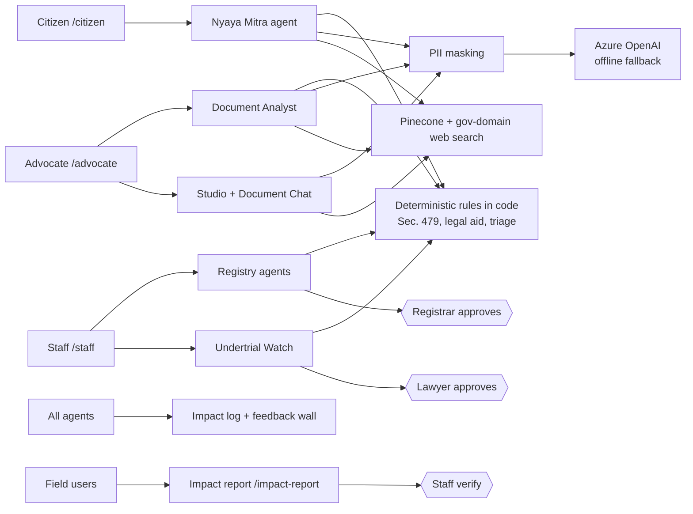

# NyayaVedika (న్యాయవేదిక): agentic AI for timely justice

**Track:** Timely Justice, Legal Backlog (Code for a Billion, impact area 07)

**Live demo:** [NYAYAVEDIKA](https://nyayavedika.delightfulmushroom-95327f3a.koreacentral.azurecontainerapps.io/) ·
**Demo video (3 min):** https://youtu.be/D3xo-yJMhwg ·
**DEMO VIDEO LATEST WITH NEW UI:** https://youtu.be/eZesGxAgIGc
**Licence:** MIT
**Live impact dashboard:** [Metrics](https://nyayavedika.delightfulmushroom-95327f3a.koreacentral.azurecontainerapps.io/metrics) ·
**Detailed evidence and research:** [docs/RESEARCH_EVIDENCE.md](docs/RESEARCH_EVIDENCE.md)
**Proven impact report:** [proven_impact_section.md](proven_impact_section.md)
**Detailed operational metrics:** [live metrics dashboard](https://nyayavedika.delightfulmushroom-95327f3a.koreacentral.azurecontainerapps.io/metrics)

[](https://github.com/chintamourya/nyayavedika/actions/workflows/tests.yml)

NyayaVedika is one platform with three doors: citizens find legal aid and understand their problem, advocates read and assemble case papers with page-cited AI help, and court staff **triage the pending docket and schedule it efficiently**. Legal rules run as deterministic code with visible reasons; a named human approves every step with legal consequences.

What is in this repository:
- **Court staff desk, built around case triage and efficient scheduling:** a first-visit guide to the whole flow, a triage queue with plain-words reasons on every case, a bench-time check before a cause list is drafted, readiness notes, a printable list under the usual listing heads, and a court diary to record proceedings and next dates
- **Undertrial Watch:** Section 479 BNSS arithmetic with blockers flagged, a draft application, and lawyer approval
- **Citizen door:** legal-aid eligibility and a drafted application, problem research from official sources, plain-language document summaries (English, Hindi, Telugu)
- **Advocate door:** Document Studio, page-cited insights and document chat in an isolated workspace
- **Evidence:** a public metrics page, a feedback wall, and a **verifiable impact report** (`/impact-report`) that the team checks before any figure is counted
- Offline-safe: without API keys every rule-based flow still works

Figures are tagged **Measured** (our product logs), **Reported** (published by the named source), **Derived** (our arithmetic on reported or measured figures) or **Estimate** (our model, assumptions stated).

---

## Problem statement

India's law already says when many undertrial prisoners are to be released. Under Section 479 of the Bharatiya Nagarik Suraksha Sanhita (BNSS), a person detained for half the maximum sentence is to be released by the court on bail, and a first-time offender on bond after one-third, unless the court, after hearing the prosecution, records reasons for continued detention. What is missing is someone, or something, that **notices the date, prepares the paperwork and puts the decision in front of a human on time**. The same gap shows up across the docket: registries need to see which of thousands of pending matters need the court first, and to list them within the bench time they actually have.

Three groups fall through the same gap:
- **People in custody and their families**, who cannot find or afford a lawyer and do not know they may be eligible for release or free legal aid.
- **Advocates**, who lose hours assembling, paginating and reading very long case papers before a hearing can be useful.
- **Courts and registries**, where triage, scheduling clashes and incomplete papers feed adjournments and a growing backlog.

### Why all three doors, not one

The backlog is a chain, and it breaks at a different link for each group. A citizen who does not know they qualify for legal aid never reaches a lawyer. A lawyer who cannot read or assemble the record in time cannot make a hearing useful. A registry that cannot see which cases are urgent lists the wrong matters. Fixing one link only moves the bottleneck to the next. NyayaVedika therefore equips **citizens, advocates and court staff together**, on the same deterministic rules (Section 479, legal-aid eligibility, triage) and the same audit trail, so what one door produces is something the next door can act on. The current repository already shares the rules, data model and audit trail across the three doors, and the system is designed so the same event stream can support a future single-case supervisor layer without forcing a rewrite of the working product.

## What we built

NyayaVedika is a set of AI agents and a lawyer workbench with three doors. Every legal rule (eligibility, Section 479 thresholds, urgency scores) is **deterministic code that shows its reasons**. The language model chooses tools, reads documents, explains and drafts. It never decides eligibility. **A human approves every step that has legal consequences.**

**How the track's four focus areas map to the three doors.** Each focus area is served at every level, not by one door alone.

| Track focus | Citizen | Advocate | Court staff |
|---|---|---|---|
| **Case triage** | Understand a legal problem sorts a situation into a category and points to the right law and office | Insights surface the issues and facts in a file | Rule-based 0-100 priority with the reasons on every row; one-click queues (custody and bail, Section 479, missed listing deadlines, statutory time limits, 10+ year old cases); Undertrial Watch |
| **Document summarisation** | Understand a court document gives a plain-language brief | Insights and page-cited chat on the lawyer's own file | Intake summaries and field extraction with page references; extracted facts kept apart from generated text |
| **Legal aid access** | Eligibility check and a drafted application | Insights give a lawyer the facts and issues for a legal-aid or release application | Alerts for people held past the Section 479 mark, with a drafted application for a lawyer to approve |
| **Scheduling efficiency** | Knowing what an order says and what to do next | Studio produces paper-books that are ready on time | Bench-time check before drafting; conflict-free weekly cause list sized by adjournment risk; must-list matters first; registrar approval; court diary feeding outcomes back |

| Door | Feature | What it does | What it eases | How impact is measured |
|---|---|---|---|---|
| **Citizen** `/citizen` (no login; English, Hindi, Telugu) | Free legal aid check | 5 questions, then an AI explanation and a drafted application | The legal-aid reach gap (about 0.15% of those entitled) | Checks, eligible, applications, partner-reported outcomes |
| | Understand a legal problem | Searches statutes and official government sites; asks for missing facts | Not knowing which law or office applies | Citizen sessions |
| | Understand a court document | Plain-language brief of an order or notice | Being unable to read what the court sent | Documents analysed |
| | Know your rights | Rights guidance, including for someone in custody | Families who do not know what to ask for | Citizen sessions |
| **Advocate** `/advocate` (lawyer token) | Document Studio | Merge, split into volumes, reorder, rotate, remove pages, OCR, bookmarks, clickable index, page numbers, all in memory | Hand-assembling paper-books in several desktop tools | Pages and operations per session |
| | AI Document Insights | Issues, Facts, Background or Summary of a PDF, DOCX, text or image (up to 50 pages). Every point has a page number and a verbatim excerpt checked against the text | Hours of reading; unverifiable AI claims | Documents analysed, upload-to-result time |
| | Chat with this document | Page-cited answers from the lawyer's own document only | Hunting through a file for one fact | Questions per session |
| | **Undertrial applications** (Sec. 479 BNSS) | Shows each case with counsel on record, the custody arithmetic and the draft; counsel ticks a five-point verification checklist, then decides to file or records why not; then follows what the court did | Eligible people waiting because nobody decided to file | Decisions to file, reasons for not filing |
| **Court staff** `/staff` | Daily desk | First-visit guide to the whole flow; triage and scheduling panels; court diary to record heard / adjourned (reason, next date) / disposed / not reached | Not knowing where to start; next dates never updated after a sitting | Proceedings recorded, earlier hearings left unrecorded |
| | 1 · Intake | Reads case files, extracts facts with page references, flags uncertain details | Re-typing case details; papers sitting unread | Files processed, details corrected |
| | **2 · Case triage** | Scores every pending case 0-100 by fixed rules, shows the biggest reasons on the row and why the case needs a person; uploaded cases always above demo data | Manual sorting of the docket; urgent matters buried | Cases triaged, Critical cases not yet listed |
| | **3 · Efficient scheduling** | Checks bench time against waiting work, drafts a conflict-free week (must-list first), shows readiness notes and a one-paragraph summary; registrar approves; prints under listing heads | Clashes, overloaded days, cases left out week after week | Cases listed, carried over and why, Critical wait versus oldest-first |
| | **Undertrial Watch** (nightly) | Computes the Section 479 mark, itemises the arithmetic, flags blockers, drafts the application. Counsel decides to file (Advocate portal); the registry records filing, hearing, the court's order and release; only the court decides | Eligible people missed because nobody checked the date | People flagged, applications filed, release orders recorded |
| | Document summary | Briefs any document without creating a case | Reading time | Documents analysed |
| **All** | Feedback wall `/feedback` | Public ratings and short notes | Quick sentiment | Responses, average rating |
| **All** | **Impact report** `/impact-report` | A 5-minute form for advocates, legal-aid lawyers, court staff, para-legal volunteers, law students and citizens: what they used, time without and with NyayaVedika, accuracy, concrete outcome. Professionals give details the team can check (Bar Council enrolment, law school); reports count only after a staff user verifies them | Unverifiable claims of impact | Verified reports, median time saved, outcomes |



**Why the design works**
- **Rules in code, not model output.** `nyayavedika/triage.py` returns `eligible`, `likely_eligible`, `needs_review` or `not_eligible`, and every status goes to a lawyer. For a three-year maximum offence, a first-time offender is eligible after one year and others after eighteen months.
- **It targets the measured gap.** NALSA's own report shows the weak points are identification, filing in some states, pending applications and surety-blocked release. Undertrial Watch lists, itemises and drafts for exactly these.
- **Human approval at every consequential step**, using LangGraph `interrupt()` with Postgres checkpoints, so a paused case survives a restart.
- **Grounded outputs.** Briefs are verified against the source. Insights need a page and a checked excerpt. Chat cites a page for every statement.
- **Privacy.** Phone, email, Aadhaar and PAN numbers are masked before text reaches any model, index or web search. Web search is limited to official domains. Advocate workspaces use random tokens stored only as SHA-256 hashes.
- **Works without keys.** With no API key the app runs offline on rules.

## How the court staff desk works

The staff door is built around **case triage** and **efficient scheduling**.

- **Start here.** A first-visit guide explains the whole flow. Tabs follow it: 1 · Intake, 2 · Triage, 3 · Scheduling. Every screen opens with what to do there and a link to the next step.
- **Today.** A triage panel (pending matters by band, and the top cases with no hearing slot, each with its reason) and a scheduling panel (next week's bench time against the waiting work) lead the page.
- **Triage.** One-click queues: custody and bail, past the Section 479 mark, Critical not yet listed, missed listing deadlines, left out of three lists in a row, statutory time limits, pending 10+ years, details to verify. Every row shows its biggest score reasons and, in plain words, why it needs a person. The view exports to CSV.
- **Scheduling.** A bench-time check before drafting; saved drafts that can be reopened or rejected with a reason; readiness notes (custody production, details to verify); an "In short" summary for the Registrar; confirmation before publishing; and a court-format print view under the usual listing heads.
- **Court diary.** After each sitting, staff record heard / adjourned (reason and next date) / disposed / not reached. Outcomes feed back into how much time the next list allows.
- **Real cases first.** Uploaded and imported cases are always listed above synthetic demo data.

**Undertrial Watch follows who holds each power under Section 479 BNSS.**
- Court staff record counsel on record from the DLSA assignment letter or a vakalatnama.
- Counsel decides whether to file, in the Advocate portal's *Undertrial applications* tab, after a five-point verification checklist.
- Court staff record the filing, the hearing, the court's order (release on bail or on bond, or continued detention, with the order date) and release from custody.
- Only the court decides release. The server refuses a step from the wrong role, and every step is kept with who recorded it and when.
- The draft application asks for release on bail or on bond, as the section provides.

## How we used AgentFoundry (AF)

NyayaVedika was built in **AgentFoundry (AF)**, the official agentic IDE for Code for a Billion. The project was created in AF, the collaborators were invited into it, and the work ran on the free smart-code tokens every participant receives.

| Stage | How AF was used |
|---|---|
| **Scaffolding** | Generating the FastAPI server, the three static doors (`/citizen`, `/advocate`, `/staff`) and the SQLAlchemy data model |
| **Agents** | Building and iterating the four LangGraph agents (Nyaya Mitra, Document Analyst, Undertrial Watch, Registry), including their `interrupt()` human-approval pauses |
| **Rules and drafting** | Writing the deterministic Section 479, legal-aid and triage engines, and the cause-list planner |
| **Testing** | Writing and running the offline test suite (about 30 files) until it passed |
| **Documentation** | Drafting this README, `HOW_IT_WORKS.md` and `docs/RESEARCH_EVIDENCE.md` |


## Scale & severity of the problem

### Scale

| Population | Figure | Source and date | Type |
|---|---|---|---|
| People waiting on a court | **5.64 crore pending cases** (district 4.98 crore, High Courts about 64 lakh, Supreme Court about 96,000) | Law Ministry, Rajya Sabha, 23 July 2026 | Reported |
| People in jail without a conviction | **4,03,302 of 5,31,949 prisoners (75.81%)**, October 2025 | NALSA, UTRC report Oct–Dec 2025 | Reported |
| People entitled to free legal aid | **About 80% of the population**, over 110 crore people | India Justice Report 2025; our arithmetic | Reported / Derived |

Every case has at least two parties, plus families and witnesses, so the people affected exceed the case count. One person can be in several cases, so we claim no exact number of people.

### Severity

- **Long detention without conviction.** Of 3,89,910 undertrials at the end of 2023, **1,19,654 had been held over a year, 64,999 over two years and 10,392 over five** (NCRB). Prisons were at **120.8% occupancy** (Reported).
- **The remedy is not reaching enough people.** In Oct–Dec 2025 the review committees **identified 14,387 prisoners, recommended 10,754, saw 9,011 applications filed and 5,864 released**. Only 2.7% of prisoners were identified (NALSA, Reported). Release rates differ by state: Maharashtra 17%, Telangana 25%, Andhra Pradesh 53% of those recommended (Derived).
- **Few people reach a lawyer.** Free legal aid reached 16,60,249 people in FY 2025-26 up to January 2026, about **0.15%** of those entitled (Derived).
- **Economic loss.** Litigants lose **₹50,387 crore a year** in wages and business income (0.48% of GDP; DAKSH, 2015–16, Reported). The state spends about **₹4,195 per inmate per month** (NCRB ₹2,669.88 crore in FY 2023–24; Derived).
- **Our estimate of avoidable custody** (Estimate): between **11,021 and 71,792 people** eligible but still held, about **₹13.9 crore to ₹361.4 crore** in direct custody cost, with ₹74.4 crore as the central case. Method and assumptions are in the evidence file.

### How the harm ripples

| Stage | What happens | Where NyayaVedika cuts the chain |
|---|---|---|
| 1. Trigger | A person crosses the half or one-third threshold and nobody checks the date | Nightly automated threshold check |
| 2. Direct harm | Continued custody without conviction; only 55% of those recommended were released | A ready, reasoned application and a named reviewer |
| 3. Spread | The household loses its earner, borrows for lawyers and travel, children may leave school; the state keeps paying | Earlier release and earlier counsel |
| 4. System feedback | Overcrowding, more adjournments, a larger backlog | Cleaner listing and complete case papers |

The cycle reinforces itself. The people not identified are the least able to find a lawyer (only 7.91% of undertrials used free legal aid in 2016–19), and each missed release adds to the overcrowding that makes the next review harder. The largest costs, to households and public trust, are also the least measured, so **we put no number on the ripples** beyond the custody floor above. Full evidence tables are in [docs/RESEARCH_EVIDENCE.md](docs/RESEARCH_EVIDENCE.md).

## Proven impact

> Full write-up with reach, reliability, feedback, field summary and limits of the evidence: **[proven_impact_section.md](proven_impact_section.md)**. Source evidence and research: [docs/RESEARCH_EVIDENCE.md](docs/RESEARCH_EVIDENCE.md).

### How we prove it: verified field reports

Activity counts show use, not impact. So every person who uses NyayaVedika on real work is asked to file an **impact report** at [`/impact-report`](https://nyayavedika.delightfulmushroom-95327f3a.koreacentral.azurecontainerapps.io/impact-report) (role-specific links such as `/impact-report?role=advocate`). Each report records:

- **who** reported, privately: an advocate gives their law school, and may add an enrolment number, the courts practised in and work experience; court staff may add a designation. These details are only for checking that the person is real; they are never published or sent to a model;
- **what** they used it on (a real matter, a sample, or a trial run) and how often;
- **before and after:** minutes for the same task without and with NyayaVedika, estimated or timed;
- **accuracy:** whether they checked the output against the original papers, and errors found;
- **the concrete outcome:** an application filed, legal aid obtained, a fact found that would have been missed, a list prepared faster.

A staff user verifies each report on the review desk (`/impact-report/review`), for example against the Bar Council roll, and writes down what was checked. **Only verified reports are counted**, and a person's words are quoted only with their permission.

### Product activity snapshot

**Status:** NyayaVedika is live and in early field use. The figures below are a measured product-activity snapshot, not a claim of verified legal outcomes. The [public metrics dashboard](https://nyayavedika.delightfulmushroom-95327f3a.koreacentral.azurecontainerapps.io/metrics) is the live source; see [docs/RESEARCH_EVIDENCE.md](docs/RESEARCH_EVIDENCE.md) for definitions, caveats and the full evidence.

### Reach and use (Measured)

| Metric | Value |
|---|---:|
| Distinct browsers, all activity | **59** |
| Public-site browsers | 49 |
| Portal visits | **223** (Citizen 38, Advocate 61, Staff 124) |
| Distinct browsers by door | Citizen 18, Advocate 17, Staff 17 |
| Browsers that used an API feature | **25** |
| Tool requests | **1,136** (Citizen 48, Advocate 149, Staff 935, 4 role unresolved) |
| Voluntary feedback responses | **7** |

Staff-door request volume includes reviewer activity, not just ordinary product usage.

| Product action | Measured total |
|---|---:|
| Citizen sessions | 53 |
| Completed five-question free legal-aid checks | 52 |
| Legal-aid applications drafted | 26 |
| Court documents analysed (summary or insights) | 13 |
| Undertrials flagged by Undertrial Watch | 25 |
| Release applications approved in the app | 7 |
| Cases triaged by the registry agent | 613 |
| Cause lists published | 4 |
| Cases scheduled in those lists | 1,216 |

The case-triage and scheduling totals include synthetic demo data as well as uploaded cases. An approved application is not evidence that a person was released. Drafts are not filed applications. Of 52 completed legal-aid checks, 26 produced a drafted application (50%, Derived).

### Reliability and speed (Measured / Derived)

- **1,122 of 1,136 tool requests succeeded (98.8%, Derived).** The 14 logged failures sit in three features: Undertrial alerts 9 of 355 requests, case management 4 of 53, hearing management 1 of 43. Seven earlier failures were attributed to internal code testing and have been fixed; the cause of the remaining failures is still being reviewed. Every other feature had no logged failures.
- Typical server latency: case intake 0.06 seconds; document tools 0.5 seconds; undertrial alerts 1.7 seconds; docket view 2.2 seconds; Document Studio 2.0 seconds; daily brief 2.8 seconds; document chat 5.0 seconds; document upload 16.5 seconds; AI Insights about 22 seconds; document summary about 29 seconds; hearing management about 53 seconds on average (n = 43).
- Samples are small (2–355 requests per feature). Latencies are indicative server processing times, not end-to-end task times or benchmark results. Longer documents account for slower summary features; summary and hearing-management time remain improvement areas.

### What users and reviewers told us (Reported)

- Seven voluntary responses averaged **4.9/5**. Excluding one team member, six external responses (three lawyers, one advocate and two citizens) averaged **4.8/5**.
- **Ease of use:** 7 of 7 rated it 5/5. **Answer quality (self-rated):** 3 "correct and clear", 4 "mostly correct". **Would recommend:** 7 of 7.
- **What changed for them (self-reported):** 6 of 7 said they understood their rights better; 5 of 7 reached legal aid or a lawyer; 5 of 7 saved time; 4 of 7 said a case moved faster.
- **Time saved on their task (self-reported):** 2 under 1 hour, 3 between 1 and 3 hours, 2 a day or more. All three lawyers reported savings of 1 hour or more.
- **Features users named:** case triage and scheduling, document insights, document chat, document summary, the free legal-aid check and the rights guide.
- **Quotes.** A lawyer in Narsapuram said the tool helped with filing PDFs, understanding case insights and chatting with documents, and that case triage and scheduling "wondered me". A lawyer in Noida said they loved case triage and scheduling. A lawyer in Kurnool said understanding cases got easier.
- **Direct reviewer feedback (lawyer, by message).** After testing the app, a lawyer reported it "working so well" and liked the workflow and how intuitive it is. They found the page references in AI document insights accurate, said the "nature of dispute" line in the case background was vague, and recommended highlighting the source context from which each issue is identified so it can be verified faster. We have logged that as the next improvement.
- Feedback is self-reported, voluntary and small (n = 7). It shows that reviewers found the tool useful and its page references accurate; it is not independent verification of outcomes, and no lawyer has certified or approved the product.

**What feedback changed in our roadmap.** (1) Highlight the exact passage behind each Insights issue so a lawyer can verify it in one click (lawyer review, Nov 2026). (2) Tighten the "nature of dispute" line in the case background (same review). (3) Allow longer document summaries (lawyer feedback, Kurnool).

### Estimated time and cost effects (Estimate, not field measurements)

Measured server processing times suggest where work may be shortened, but the manual baselines and human-review times below are assumptions, not observed comparisons:

| Task | Estimated time saved |
|---|---:|
| Read a 40-page file and list issues/facts | About **25–70 minutes** |
| Brief a long document | About **15–55 minutes** |
| Assemble a paper-book | About **40 minutes–2.5 hours** |
| Check Section 479 eligibility for 50 undertrials | About **2.5–6.5 hours** |

The self-reported time savings above (1–3 hours for most lawyers, a day or more for two respondents) fall in the same range as these estimates, which is encouraging but not a controlled comparison.

At the derived direct custody cost of about **₹4,195 per inmate per month**, 100 people released three months earlier would correspond to about **₹12.6 lakh** in avoided direct custody cost. This is a formula, not a realized saving; 7 release applications have been approved in the app to date, and no release outcome is claimed. Full assumptions and calculations are in [docs/RESEARCH_EVIDENCE.md](docs/RESEARCH_EVIDENCE.md).


## Run it

```bash
pip install -r requirements.txt     # Python 3.12
cp .env.example .env                # SQLite + no API keys; set distinct long random DEMO_TOKEN_* values to run the app
python scripts/reset_demo.py        # seeds synthetic data
python server.py                    # http://127.0.0.1:8000
python -m unittest discover -s tests
```

Open `/citizen`, `/advocate` or `/staff` (the staff desk opens with a short guide on the first visit). Share `/impact-report?role=advocate` (or `legal_aid_lawyer`, `court_staff`, `paralegal`, `law_student`, `citizen`) to collect field evidence, and verify reports at `/impact-report/review` with the staff token. Add `AZURE_OPENAI_*`, `PINECONE_API_KEY` and `TAVILY_API_KEY` to `.env` to switch on the LLM, vector search (needed for document chat) and web search. For Docker Compose, configure the database settings in `.env` as described at the top of `docker-compose.yml`. Scanned pages need Tesseract with language packs (`apt install tesseract-ocr tesseract-ocr-hin tesseract-ocr-tel`). `docker compose up --build` runs the full stack.

## Known limits

- Triage points, income limits and the statutes table (46 rows of demo data) need lawyer review. The demo uses static role tokens, not real authentication. Set `DEMO_MODE=false` and use real authentication before any deployment with real data.
- The release check sees only docket fields, so a lawyer confirms before filing. Records are fragmented, so we use bulk imports and OCR of remand sheets, not a live e-Prisons link.
- Names and addresses are not masked. Do not upload real case files to a hosted model without consent.
- Document chat needs Pinecone and the language model. Studio takes PDFs only, and Insights are capped at 50 pages.
- Poverty can still block release when a court has ordered it, for example when no surety can be found.
- Outputs are legal information for a lawyer to review, not legal advice. Nothing is filed without a human decision.
- Scheduling does not replace the court's own listing practice: timings are estimates, the Presiding Officer decides the order of calling, and nothing is listed until the registrar publishes.
- Impact reports hold identity details for verification. Keep the staff token and the CSV export private; delete a report when its author asks.

## Licence

Open source under the [MIT licence](LICENSE). Built for the Code for a Billion hackathon by Code for India, using AgentFoundry (AF) as the IDE.