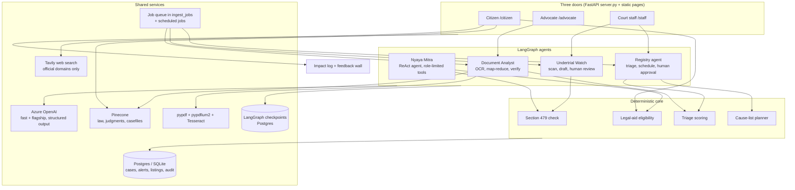

# NyayaVedika: how each product works

**What "agentic" means in the current build.** NyayaVedika uses LangGraph agents that plan, call tools, run in parallel, verify their own output, and pause for a human decision. The system keeps the legal rules in plain code and requires a human at every step with legal consequences. The same architecture supports proactive follow-up and a future case-level supervisor without removing the approval gate.

Contents: 1 Design rules · 2 Architecture · 3 Shared foundations · 4 Citizen door · 5 Advocate door · 6 Court staff door · 7 Measurement and feedback · 8 Safety, privacy and access control · 9 Testing · 10 Current limits · 11 Roadmap and next improvements

---

## 1. Design rules

These six rules shape every product below.

1. **Code decides, the model talks.** Eligibility, the Section 479 thresholds and urgency scores are deterministic functions that return their reasons. The language model reads documents, asks questions, explains and drafts. It never decides who is eligible.
2. **A human approves every consequential step.** Release applications, cause lists and legal-aid applications are drafts until a named person approves them. Each approval is written to an audit log.
3. **Every claim is checked against a source.** Dates and section numbers must literally occur in the document. Insights carry a page number and a verbatim excerpt. Legal research answers cite retrieved official pages. Anything that cannot be verified is dropped, not softened.
4. **Private by default.** Phone, email, Aadhaar and PAN numbers are masked before text reaches a model, a vector index or a web search. Web search is limited to official domains.
5. **Works without keys.** With no API key the app runs on rules and an extractive summariser, and labels its output as such. The same code paths are tested offline.
6. **No single group can clear the backlog.** Each door removes a different delay (the citizen's not knowing, the lawyer's unreadable record, the registry's unseen urgency), and all three share the same rules and audit trail. Section 3.7 shows how they fit together.

## 2. Architecture

**Stack.** Python 3.12, FastAPI and Uvicorn, Pydantic for typed model output, LangGraph for agent graphs and checkpoints, Azure OpenAI for the language model, Pinecone with hosted embeddings for retrieval, Tavily for web search, pypdf, pypdfium2 and Tesseract (English, Hindi, Telugu, Tamil, Kannada, Marathi, Bengali) for OCR, SQLAlchemy over SQLite for development and Postgres for deployment, Docker and docker-compose, and a GitHub Actions workflow that builds the image. The project was built in AgentFoundry (AF), the Code for a Billion IDE. AF is the build environment and not a component of the running product.

## 3. Shared foundations

### 3.1 The language-model layer (`llm.py`)

- One client for Azure OpenAI. Calls ask for **structured output**: the model must return JSON that fits a Pydantic class, and a bad shape is an error, not a guess.
- A **fast** deployment handles short jobs (search strings, document type, claim checks) and a **flagship** deployment handles synthesis, so cost and latency stay low.
- Every call **masks personal identifiers first**.
- Citizen-facing generated prose follows the selected English, Hindi or Telugu language even when the input uses another language. A guarded rewrite preserves numbers, citations and URLs; if it fails validation or the model is unavailable, the original answer is retained.
- Tests swap in a scripted backend (`set_backend()`), so full agent graphs run with no network.

### 3.2 Reading documents (`ocr.py`, `documents.py`)

- Native text is taken from each PDF page first. Tesseract runs only on pages with too little text, using a text-density test and a word-confidence filter, so a mixed file is not re-OCR'd needlessly.
- DOCX, TXT, MD, CSV and images (PNG, JPG, TIFF, BMP, WebP) are supported. Pages keep their numbers, which is what makes page citations possible.
- Files get a deterministic id from their content hash, so uploading the same file again finds the saved copy.
- Bytes and extracted pages live in `storage/`, and graph state carries only ids and small results. This keeps checkpoints small.

### 3.3 Knowledge and search

- **Pinecone** namespaces: `law` (bare acts, NALSA schemes), `judgments` (precedents), `casefiles` (uploads, filtered by case) and a legal-aid index. A local JSON dump supports keyword search when Pinecone is not configured.
- **Web search** goes through Tavily and, by default, only to the official domains in `NYAYAVEDIKA_TRUSTED_DOMAINS`.
- The **legal-aid knowledge base** (`legal_aid_kb.py`) chunks NALSA material by heading (about 800 tokens with overlap), tags each chunk as primary (government) or secondary, and keeps the source URL. A curated `legal_info.html` adds short entries, each with the official link and the date it was checked.

### 3.4 Data, queues and scheduled work

- Tables include courts, benches, court calendar, reference tables for case types and stages, statutes, cases, hearings, documents, document analyses, ingest batches and jobs, triage scores, queue state, cause lists, listings, deferrals, alerts, legal-aid requests, field feedback, audit log and agent runs.
- `ingest_jobs` doubles as a **work queue**, with no Redis or Celery. A worker claims jobs with `SELECT ... FOR UPDATE SKIP LOCKED` on Postgres or a compare-and-set update on SQLite, writes a heartbeat, returns a silent job to the queue after a stale period, and retries failures with a growing delay.
- Scheduled jobs run from cron: `undertrial_scan` (nightly), `aging_update` (nightly), `weekly_cause_list` (Fridays) and `daily_topup` (mornings). Each run writes an `agent_runs` row, so a missed night is visible.

### 3.5 Checkpoints and human pauses

LangGraph's `interrupt()` pauses a graph at a human decision. With the Postgres checkpointer, a paused release application or cause list **survives a restart** and can be resumed on the same thread, even hours later.

### 3.6 Access and audit

Three roles (citizen, lawyer, staff) come from bearer tokens checked server-side, and a single policy table lists which roles may call each route. The client cannot choose its own role. Some steps are checked again inside the rule itself: in the Section 479 workflow, only the lawyer role can decide whether to file, and only court staff can record filing, hearing, the court's order and release. Every human decision goes through `audit.record()`, which writes an `audit_log` row and a counts-only `decision` event.

### 3.7 How the three doors connect

The backlog is a chain of delays, and each door removes a different one. A typical path, shown as one person's journey:

| Step | Door | What happens | Where it is built |
|---|---|---|---|
| 1. Find out | Citizen | A family learns that the person qualifies for free legal aid and gets a drafted application | Section 4.1 |
| 2. Get a lawyer | Citizen, then legal-aid office | The request moves to `lawyer_assigned` | Section 4.1, step 7 |
| 3. Prepare | Advocate | The lawyer reads the record with page-cited Insights and assembles the paper-book | Sections 5.1 to 5.3 |
| 4. Notice the date | Court staff | Undertrial Watch flags a Section 479 case and drafts the release application, and a legal-aid lawyer approves it | Section 6.3 |
| 5. Get listed | Court staff | A Critical case is proposed a fast-lane slot, and the registrar approves the cause list | Section 6.4 |
| 6. Learn | All | The outcome is recorded and feeds adjournment estimates and the impact log | Sections 6.4 and 7 |

What the doors share in the current build: the deterministic rules (Section 479, legal-aid eligibility, triage), the data model, the audit log and the impact log. They are intentionally separate records at the moment: a citizen's legal-aid request, the advocate's workspace and a staff docket case are distinct objects. The journey above is therefore a design view, not a single traced workflow, and the next evolution is a case-level supervisor that joins these records without weakening the human review gates.

---

## 4. Citizen door (`/citizen`)

No login. English, Hindi and Telugu. Each tool below is a guided flow built so a first-time litigant is not asked to write a legal argument.

### 4.1 Free legal aid check

**Purpose.** Tell a person in plain language whether they qualify for free legal aid under Section 12 of the Legal Services Authorities Act, 1987, where to go and what to carry.

**How it works.**
1. **Five questions** about custody, gender or age, caste, disability and income, plus an optional free-text box for the person's situation and optional documents.
2. **Deterministic check** (`legal_aid.check_eligibility`). Each Section 12 category the person ticks becomes a ground with its clause. Income is compared with the State's income limit.
   - The limit comes from a State table. If a value is missing or older than a set number of days, it is confirmed from a trusted official site and written back with its source and date. The rule engine itself never waits on the web, and falls back to a default limit labelled as a default.
   - Outcomes are `likely_eligible`, `possibly_eligible` (with a list of missing facts) and `not_on_facts_given`.
3. **Practical output.** The right forum for the court level, the DLSA office and helpline, the documents to carry (built from the grounds), numbered next steps, a Lok Adalat note when the dispute can be settled, and urgent numbers when custody, domestic violence or a child at risk is mentioned.
4. **Explanation.** The knowledge index retrieves relevant NALSA passages, and the model writes a plain-language explanation in the selected language that cites them. It explains the result and never changes it.
5. **Draft application.** The model drafts a formal application in the selected language and the formatting a legal-aid clerk expects: addressee, subject line, numbered paragraphs, the Section 12 clause, a prayer for a panel lawyer, and `[placeholders]` for anything not given. It is told never to invent facts. Without a model, a template is used.
6. **Follow-up questions.** A person can ask a limited number of follow-up questions per session, answered from the knowledge index and, when supplied, the person's own document. The limit is tracked per session.
7. **Status.** A request moves through `checked → drafted → applied → lawyer_assigned → closed`, so partners can report outcomes.

**What it eases.** People who do not know they qualify, and clerks who receive incomplete or informal applications.

### 4.2 Understand a legal problem

**Purpose.** Give a grounded answer to "what can I do about this?" using current official sources, not model memory.

**How it works** (`legal_problem.research`).
1. **Validate.** An empty description, one over 6,000 characters, or an over-long location is refused with a clear message.
2. **Understand.** A typed `ProblemUnderstanding` records the category (one of seven fixed categories, otherwise the question is refused as unclassifiable), facts, parties, events, dates, jurisdiction and missing information.
3. **Ask for the place.** If no State or district is given, the agent asks one question instead of guessing.
4. **Search twice in parallel.** The fast model writes two distinct search strings. Both run at once against trusted official domains. Each result's URL is normalised and kept only if it is an official page.
5. **Collect sources.** Up to ten numbered sources with short excerpts are kept.
6. **Answer from the sources.** The model writes points and must tag each with the IDs of the sources that support it. Points whose IDs do not match a retrieved source are removed.
7. **Fail honestly.** If any search fails, no partial answer is returned. If no readable official source is found, the tool says so and writes no legal answer.

A thin chat layer decides each turn whether to ask one clarifying question, reply conversationally or run the research. It uses only the last five user turns, and legal content still comes only from the research step. The explicitly selected output language takes precedence over the language used in the user's messages.

**What it eases.** Not knowing which law or office applies, and the risk of confident wrong answers from an ungrounded model.

### 4.3 Understand a court document

**Purpose.** Turn an order or notice into plain language.

**How it works.** The upload goes through the shared summarisation engine (Section 6.1) in `summary_only` mode, which creates no case. Four outputs are produced: a three-line glance, a one-page brief with page references, a five-to-eight-sentence plain-language version, and structured fields (dates, parties, next steps). Citizen-facing prose follows the selected language. Dates and section numbers are verified against the page they cite. The result is cached by content hash. Without a model key the extractive summariser runs and every output is labelled "extractive".

### 4.4 Know your rights

**Purpose.** Short, sourced answers on common situations (FIR, arrest rights, RTI, legal aid, Lok Adalat, consumer and cyber complaints, domestic violence, maintenance, wages, cheque bounce, helplines).

**How it works.** The question is matched against the curated entries and the NALSA index (semantic search when Pinecone is on, keyword ranking otherwise). The answer shows the official links with the date each was checked.

### 4.5 The conversational agent (Nyaya Mitra)

`agents/assistants.py` builds a ReAct agent per role. It is used by the staff Registry Copilot and the assistant endpoints, and the citizen flow in the current build centres on the guided tools above while preserving the same event and safety model across channels.

- **Intent rules narrow the tools.** A rules table picks the tools relevant to each message (custody, free lawyer, office, case status, alerts and so on), plus a few core tools. No extra model call is made for intent, which avoids doubling requests and hitting rate limits.
- **Role-limited tools.** An agent gets only the tools whose roles include it. A citizen cannot call docket tools.
- **Side effects need a clear yes.** Tools that change something (requesting a release review, preparing a cause list) are never run on the model's say-so. The agent asks, and runs the tool only after the person answers yes on the next turn.
- **Safety lines first.** For custody, domestic violence, child at risk or online harassment, urgent numbers (112, 15100, 1930, cybercrime.gov.in) appear before the answer. Citizens always get a next step, the helpline and "legal information, not legal advice".
- **Clarifying questions** use `interrupt()`, so a conversation can pause and resume.
- **Offline.** A deterministic `FrontDoor` answers when no model is available.

---

## 5. Advocate door (`/advocate`)

Lawyer-only. Each browser session gets a private workspace with a random token, stored only as a SHA-256 hash. Every document, insight and chat is scoped to it.

### 5.1 Document Studio

Nine PDF operations, in memory and not stored: merge, split (by page ranges into volumes, every page, or two halves), reorder, rotate, remove pages, OCR text export, bookmarks, a clickable index and page numbers (the last two are drawn as overlays with ReportLab). A page grid supports select all, odd, even and invert, and fills bookmark and index entries from the selection. Up to three PDFs per run, 50 pages each.

**What it eases.** Assembling and paginating a paper-book across several desktop tools.

### 5.2 AI Document Insights

**Flow.**
1. **Read.** The file is extracted (OCR where needed) and saved to the workspace. A repeat upload of the same file reuses the saved copy.
2. **Choose an insight:** Issues, Facts, Case Background or Summary, with optional guidance (up to 1,000 characters). Guidance can steer focus. It cannot override the grounding rules.
3. **Read long documents in parallel parts**, then combine the part notes. Extraction is reused across insights.
4. **Return points with evidence.** Each point has a page number and a verbatim excerpt. Inferences are labelled as inferences.
5. **Verify.** The excerpt must be found in the extracted text of that page. A point that cannot be matched is dropped.

**What it eases.** Hours of reading long records, and AI claims a lawyer cannot check.

### 5.3 Chat with this document

1. After upload, the document is split into passages and indexed in Pinecone for that workspace and document only.
2. A question retrieves the top five passages using **hybrid search**: semantic matching combined with keyword matching through rank fusion. Retrieved excerpts and file names are masked before reaching the model.
3. The model answers from those passages only, with `[p. N]` citations, and the source excerpts appear beside the answer. If the passages do not answer the question, it says so.
4. Only the last five messages (1,500 characters each) are used, and history is not saved.

Chat needs Pinecone and the language model. Studio works without them.

### 5.4 Undertrial applications (Section 479 BNSS)

The lawyer's side of Undertrial Watch (Section 6.3). Each case shows counsel on record (entered by court staff from the DLSA assignment letter or a vakalatnama), the custody arithmetic, any blocker such as several pending cases, and the draft application with a Word download.
- **Decide to file** unlocks only after the five-point checklist is ticked: custody period from the certificate or remand orders, offence not punishable with death or life, delay not caused by the accused, no other detaining case, first-offender status.
- **Not filing** needs a reason and can set a check-again date.
- A lawyer types their name once to mark and list first the cases where they are counsel on record, or show only those.
- After the decision the tab shows what the court registry recorded: filing, hearing, the court's order and release.

### 5.5 Session impact panel

Shows pages handled, operations, documents analysed, insights generated, insights reused without re-extraction, and time from upload to result. These are real session counts and not field results.

---

## 6. Court staff door (`/staff`)

The staff door is built around two jobs: **case triage** (which pending matters need the court first, and why) and **efficient scheduling** (a weekly cause list that fits the bench time actually available). The tabs follow the flow: Today → 1 · Intake → 2 · Triage (Docket) → 3 · Scheduling (Cause list), with Document summary and Undertrial Watch alongside.

### 6.0 The daily desk (Today)

- **First-visit guide.** The first time a staff user signs in, a card explains the four steps (receive papers, triage, schedule, hear and record), what the system does at each step and what the person does, and who approves. It can be reopened at any time ("How this desk works").
- **Case triage panel.** Pending matters by band (click a band to open it), and the highest-priority cases that hold no hearing slot yet, each with its main reason. Uploaded and imported cases are always listed above synthetic demo cases.
- **Scheduling panel.** For next week: bench time available (holidays and judges on leave removed) against the expected time of the waiting cases, the number of must-list matters, and a one-click route to prepare or review the draft.
- **Court diary.** Matters on published cause lists for any day, grouped by bench and time, with a "check before the call" column (custody production, details to verify). After the sitting, staff record **heard / adjourned (reason and next date) / disposed / not reached**. The next date must be after the hearing date; a correction never counts an adjournment twice; every entry is in the audit log. Earlier hearings with no outcome recorded (last 30 days) are listed separately.

### 6.1 Intake: files in, cases out

The web request is thin: it validates, stores bytes by content hash and writes one ingest job per file. Reading and analysis happen in the **worker**. A batch has a file-count and size limit and one of five modes: `separate`, `one_case`, `existing_case`, `by_folder` (a folder named like a case number keeps that number) and `summary_only`.

**Worker stages:** `queued → reading → summarising → extracting → scored | proposed | needs_review | failed`.

1. **Read** with OCR as needed.
2. **Summarise** (`summarise.py`). Documents above about 12,000 tokens use map-reduce: split into parts with paragraph cuts and one paragraph of overlap, map the parts in parallel at a limited rate, **tree-reduce** in groups so no call ever receives more than the single-pass limit, then produce the final brief. Indic scripts are counted with a stricter token estimate. Dates and section numbers are verified against the cited page, then the document, or removed.
3. **Extract** (`extraction.py`). The document type is classified (FIR, order, petition, bail or custody paper, other). Uploaded text is treated as untrusted evidence, never as instructions to the model. A `CaseDraft` is proposed by the model or by regex rules. **Every model-proposed date and section must literally occur in the source or it is dropped.** Missing or low-confidence fields mark the case `needs_review`, and the unverified value is not used. Every field keeps its provenance.
4. **Provisional score.** An unknown custody status on a criminal matter is treated as possible custody and never scored low.
5. **Merge.** With several documents in a case, a case-level merge runs, and contradictions go to `needs_review`.
6. **Fast lane.** A Critical or release-eligible case is proposed a slot in the nearest open draft cause list (`proposed`).

**What it eases.** Re-typing case details into the docket, and cases sitting unseen in a pile of files.

### 6.2 Docket triage

`triage.score_case` gives each pending case a 0 to 100 priority with human-readable reasons.

| Factor | Effect |
|---|---|
| Case type | Base urgency (habeas corpus 30, bail 24, family matters 18, down to 4 for "other") |
| Waiting time | Points per year since the case became ready to list, capped, with a flag at ten years |
| Statutory deadline | Small boost for time-bound laws (cheque bounce, interim maintenance, domestic violence) |
| Custody | Points for an accused in custody, a flag when the custody date is missing, extra points when the Section 479 threshold is crossed, a smaller boost when custody reaches 75% of it (configurable) |
| Vulnerable party | Points for a senior citizen, woman or child, or person with disability |
| Chronic adjournment, near disposal, dormancy, legal aid | Smaller adjustments |

The score maps to a band (Critical, High, Medium, Routine). **A case that appears past the Section 479 mark is always Critical**, whatever its score. The weights and reference tables are editable, are stored with a `rules_version`, and are shown on the staff screens (`GET /api/rules`), so a registry can audit any score. A route is recommended for each case, and suitable matters are pointed to Lok Adalat, mediation or compounding.

**On the Docket screen:**
- **Triage queues**, one click each: custody and bail first, past the Section 479 mark, Critical not yet listed, listing deadline missed, left out of three published lists in a row, time-bound by statute, pending 10+ years, details to verify.
- **Score reasons on the row.** The largest point contributions from the stored score (for example "+20 custody past the Section 479 mark, +15 accused in custody") appear under the score, so a case need not be opened to see why it ranks where it does.
- **Why it needs a person**, in plain words and built only from stored facts: listing deadline passed with no slot held, must-list next, next date already passed with no outcome recorded, custody details missing, a detail read from the papers that is uncertain.
- **Uploaded and imported cases first**, then synthetic demo cases; priority order within each group. The view can be exported as CSV.

### 6.3 Undertrial Watch

**Section 479 check** (`triage.undertrial_release_check`).
- Not run when the person is not in custody, the date or sentence is missing, or the offence is punishable with death or life.
- The threshold is **one-third of the maximum sentence for a first-time offender and one-half otherwise**. When first-time status is unknown, the lower limit is used, so nobody is missed.
- Result statuses: `eligible`, `likely_eligible` (one-third crossed, first-offence status unknown), `needs_review` (a blocker such as several pending cases) and `not_eligible` (with the percentage of the threshold reached).
- Custody days, the thresholds and the basis are returned so the arithmetic is shown.
- Word drafts include the court application and a separate custody-record review request in English, Hindi or Telugu. It identifies the recorded custody period for verification and asks officials to consider appropriate action under Section 479. The calculation is labelled preliminary; missing values remain placeholders. A lawyer or authorised officer must check it before sending.

**The agent** (LangGraph): `scan → draft (one per new candidate, in parallel) → save → review [human interrupt] → apply`.
1. **Scan** finds custody cases past the threshold or within a configurable share of it. Custody cases missing a custody date or sentence go to a "data needed" list with where to get each fact (the custody certificate, the remand order, the Act and section charged).
2. **Draft** writes a release application for each new candidate, from a model or a template, with a **checklist of five conditions a lawyer must verify**: custody period, offence not punishable with death or life, delay not caused by the accused, no other pending detaining case, and first-time status.
3. **Review** pauses for a legal-aid lawyer or committee member. Dismissing needs a reason and can snooze. A dismissed case does not return the next night, only after the snooze date or when its custody facts change.
4. **Who does what, as in court.** The lifecycle is `pending → approved → filed → heard → release_ordered → released`, with `denied` (continued detention) and `dismissed` (not filing). Each step belongs to the person who holds that power, and the server refuses it from anyone else:
   - **Counsel for the undertrial** (usually a DLSA legal-aid lawyer), in the Advocate portal's *Undertrial applications* tab: verifies the five-point checklist, then decides to file (`approved`) or records why not (`dismissed`, with an optional check-again date).
   - **Court staff (registry)**, in the Staff portal: record the application as filed (with the petition number, if any), the hearing, **the court's order** (release on bail after one-half, on bond for a first-time offender after one-third, or continued detention with reasons recorded, each with the order date), and release from custody once the bond is accepted.
   - **Counsel on record.** Court staff record which lawyer acts for the person, from the DLSA assignment letter (legal aid) or a filed vakalatnama, with its reference number; nobody assigns themself. The lawyer's tab shows counsel on each case and can be filtered to "only my cases" by name. (This demo uses one shared lawyer login; a deployment would give each lawyer their own login and enforce the link on the server.)
   - **The court** alone decides release. NyayaVedika never records an order the registry has not entered, and a person is not shown as released until a release order is on record.
   - Every step is kept on the alert with who recorded it, when, and the order details, and is written to the audit log. The jail superintendent's duty under Section 479(3) is supported by the custody-record review request (English, Hindi, Telugu).

It runs nightly at about 01:00 and on custody-field changes, after re-scoring stored custody bands. The Document Analyst and the worker also hand a case to it when a file shows custody past the threshold.

**What it eases.** Eligible people missed because nobody checked the date.

### 6.4 Cause list (Registry agent)

`triage → review → schedule → explain → save draft → approve [human interrupt] → publish`

1. **Triage** re-scores only changed cases and reads the pending docket and queue state from the tables.
2. **Review.** The model inspects only edge cases the rules can miss (custody without dates, very old cases stuck at early stages, rule-flagged oddities). It may propose a bounded adjustment of at most ±10 points with a one-line reason and list missing data. Every adjustment is logged with its reason in the score history. Without a model, only data-quality notes are produced.
3. **Schedule** (`scheduler.plan_week`). The planner is deterministic, so the same input gives the same plan.
   - Higher priority is listed earlier, with an **aging boost** per consecutive deferral and per week past the listing deadline.
   - A case deferred repeatedly or past its deadline becomes a **must-list**, and some bench capacity is reserved for must-list cases.
   - Each case takes its **expected time**: estimated minutes weighted by its adjournment risk, so lists are full but not overloaded.
   - **Advocate double-booking** across courtrooms is avoided with a buffer.
   - Matters under the same Act and section are **batched** back to back, and benches are matched to case types.
   - Slots use the court calendar and holidays, first-fit placement, and backfill with short matters.
   - A reason is stored for every case left out (an append-only `deferrals` record).
   - `check_plan` verifies invariants: nothing lost, no advocate double-booked, no bench over capacity.
4. **Explain.** A short registrar's note compares the plan with a naive oldest-first baseline and lists data issues and release-eligible cases.
5. **Approve.** The graph pauses. Only the registrar publishes.
6. **Publish** writes hearings, next-hearing dates and the audit log.

After hearings, the outcomes recorded in the court diary (`record_outcome`: heard, adjourned, disposed, not reached) feed **learned adjournment rates** per case type and stage, smoothed so a few records do not swing the estimate. A new Critical case can be given a **fast-lane** slot in the nearest open draft, which the registrar accepts, moves or holds.

**On the Cause list screen:**
- **Will the week fit?** Before anything is saved, `GET /api/scheduling/preview` compares bench time (sittings minus holidays and leave) with the expected minutes of the waiting cases, counts must-list matters against the reserved time, and gives a one-line verdict. It uses the same eligibility, hold, must-list and expected-time rules as the planner and re-scores stale cases in memory, so its counts match the draft.
- **Saved lists.** A draft or published list can be reopened later (`GET /api/cause-lists`, `GET /api/cause-lists/{id}/view`), rebuilt from its current slots, including moves and holds. A draft can be rejected with a reason.
- **Readiness notes** for listed matters: custody production to arrange, details to verify, custody date or stage missing.
- **"In short"**: one paragraph a registrar can read before approving: matters listed, must-list placed first, bench time used, advocate clashes, cases carried over and why, and the wait of Critical matters compared with listing oldest-first.
- **Approval** needs an explicit confirmation by the authorised user; publishing creates the hearings.
- **Print view** in court format: per day and bench, matters grouped under the usual listing heads (judgment and orders, bail and custody, fresh matters, charge and issues, evidence, arguments, pleadings, execution) with running item numbers. Drafts are marked "not for circulation". Timings are estimates; the Presiding Officer decides the order of calling.

**What it eases.** Clashes, overloaded days and cases that wait behind others week after week.

### 6.5 Other staff tools

- **Document summary** works without creating a case (Section 4.3's engine). Generated text and facts found in the document are shown apart, and dates or sections that do not appear in the document are removed and listed.
- **ADR routing** lists cases suited to Lok Adalat or mediation and logs an event for each.
- **Registry Copilot** answers docket questions (priority cases, deferral report, case lookup) and prepares a draft cause list only after the user says yes.

---

## 7. Measurement and feedback

**Impact log.** Each feature writes counts-only events: citizen sessions, legal-aid checks, applications and partner-reported outcomes, documents analysed (with pages and OCR pages), people flagged, release applications approved, cases triaged, ADR candidates, cause lists published (with conflicts avoided and critical wait gained), feedback and human decisions. `GET /api/impact` aggregates them and `/api/impact/export.csv` exports the raw log for staff. The public `GET /api/demo/metrics` endpoint exposes aggregate activity and summarized feedback only; open the [public metrics dashboard](https://nyayavedika.delightfulmushroom-95327f3a.koreacentral.azurecontainerapps.com/metrics) for per-door and feature totals, distinct-browser estimates, success rates and server latency. Browser counts are not counts of people, and activity does not prove a legal outcome. [docs/RESEARCH_EVIDENCE.md](RESEARCH_EVIDENCE.md) documents the current live-use snapshot and its limits.

**Feedback wall** (`/feedback`). A short form (about three minutes) for advocates, lawyers, court staff and citizens. Only role and star rating are required. The questions map to the four judging criteria: how often the problem occurs and how many people it affects, the costs it causes, the rating and accuracy of the tool, and outcomes and time saved. Free text is masked, names are cut to a first name, and staff can hide an entry.

**Impact reports** (`/impact-report`). The verifiable record behind proven impact. A shareable form (about five minutes; `?role=advocate`, `legal_aid_lawyer`, `court_staff`, `paralegal`, `law_student` or `citizen` preselects the role) asks what the person used and on what (a real matter, a sample or a trial), minutes for the same task without and with NyayaVedika (estimated or timed), whether the output matched the original and how many errors were found, and the concrete outcome. Professionals also give details the team can check: an advocate's law school (enrolment number, courts practised in, empanelment with a legal services authority, designation and work experience are optional). The server (`nyayavedika/impact_reports.py`) validates every answer, masks phone numbers, emails, Aadhaar and PAN in free text, requires consent to store, records a separate choice about quoting, and limits submissions per connection.
- `POST /api/impact-reports` and `GET /api/impact-reports/options` are public.
- Listing (with identities), the summary, CSV export and `POST /api/impact-reports/{id}/verify` are staff-only. Verification is a human act with a note of what was checked, written to the audit log.
- The summary (`GET /api/impact-reports/summary`) counts **verified reports only**: verified professionals, use on real matters, median minutes and share of time saved, total hours saved, documents and people helped, accuracy checks, outcomes, and quotes the authors allowed.
- The review desk is `/impact-report/review`.

**Pilot tooling.** `pilot/pilot_log_template.csv` and `scripts/pilot_report.py` turn an authorized, anonymized per-case log into agreement with lawyer verdicts, minutes saved and flagged cases. Early live-use activity and voluntary feedback are available, but no verified legal-outcome or manual-versus-tool time study is claimed. Measurement definitions and the evidence boundary are in [docs/RESEARCH_EVIDENCE.md](RESEARCH_EVIDENCE.md).

## 8. Safety, privacy and access control

- **Roles** come from server-side tokens and a route-by-route policy. Anything the client sends as a role is ignored.
- **Masking** of phone, email, Aadhaar and PAN numbers happens before text reaches a model, index or search.
- **Official domains only** for web search.
- **No partial legal answers.** Research either completes with sources or says it cannot.
- **Disclaimers** and the helpline appear on citizen outputs.
- **Workspace isolation** for the advocate door, with chat retrieval filtered by workspace and document.
- **Audit trail** of every human decision, and a table of agent runs for scheduled jobs.
- **Impact-report identities** (name, email, enrolment, law school) are stored only with consent, readable only with a staff token, never published and never sent to a model.

## 9. Testing

About 30 test files run offline, with a scripted model backend and no keys. They cover the Section 479 engine against 21 hand-derived cases, legal-aid eligibility and explanation, legal-problem research, agent flow and resilience (including pauses and resumes), the worker queue, intake modes, extraction and summarisation (including real judgments), scheduling invariants (no advocate double-booked, no bench over capacity, nothing lost), efficiency, access tokens, feedback, the data model, the front door and frontend, and the advocate tools (workspace isolation, grounding, file types, re-upload reuse, Studio operations, chat scoping). The tests use invented cases, so they show behaviour as designed, not performance in a real court.

## 10. Current limits

- **Demo access.** Roles use static tokens, not real authentication, unless the deployment is configured for a different model.
- **Unverified rules.** The 21 Section 479 cases, triage weights, income limits and the statutes table need lawyer review before a live legal workflow is trusted in a production setting.
- **No live record link.** The custody check uses docket fields, so a lawyer confirms the dates. There is no direct connection to e-Prisons or NJDG in the default stack.
- **Masking scope.** Names and addresses are not masked in all paths, so real files should not be uploaded to a hosted model without consent.
- **Document limits.** Studio takes PDFs primarily, and Insights are capped at 50 pages. Chat needs Pinecone and a language model.
- **Model dependencies.** Azure OpenAI and Pinecone are optional enhancements; the project still runs with rules and offline fallback.
- **Scheduled jobs run from cron.** The app includes the worker and scheduler logic, but deployment still depends on a host job runner.
- **Field data is still partial.** The measurement layer and feedback collection are in place, but field-verified legal outcome studies are still the next phase.

## 11. Roadmap and next improvements

The current codebase already delivers the core product set and the measurement scaffolding. The next improvements are the practical steps for deployment, legal review and scale, not a reset of the product.

### Hardening and deployment (next)

- **Real authentication** (OIDC single sign-on) with court, DLSA and jail roles, and per-court data separation.
- **Lawyer-reviewed rules.** Independent review of the Section 479 cases, triage weights and income limits, with the reviewer's name and date stored with each rules version.
- **Live data adapters** for e-Prisons, NJDG and committee reports, with an import path for bulk spreadsheets and OCR of remand sheets, so custody dates come from records and not typing.
- **Stronger masking**, including names, addresses and case numbers, with an option to run an open-weight model on the partner's own server for sensitive files.
- **Observability.** Traces for every agent run, cost and latency per call, and alerts on failed scheduled jobs.

### More agentic workflow and integration (next)

- **A supervisor agent per case.** One graph that plans the preparation of a case end to end (read the file, find missing facts, check eligibility, draft, schedule) and hands each step to specialist agents while pausing only at human decisions. This is the step that links a citizen's legal-aid request, the advocate's workspace and the staff docket case into one record.
- **Proactive follow-up.** Agents that notice a missing custody certificate or surety paper and send a consented reminder to the family, paralegal or jail legal-aid clinic by SMS or WhatsApp, then continue when the document arrives.
- **Precedent-aware drafting.** Release and bail applications that retrieve and cite relevant judgments from the `judgments` namespace, with every citation verified against the retrieved text before it is shown.
- **Self-checking loops.** A second agent that tries to find errors in a draft (wrong threshold, missed exclusion, unsupported claim) and sends it back, with the checker's findings visible to the reviewer.
- **Outcome learning.** Use recorded outcomes (released, denied, adjourned) to improve adjournment estimates and flag cases likely to stall, with calibration checks and a record of what changed.
- **Voice and more languages.** Spoken input and output, and more Indian languages for the citizen door, tested with native speakers.

### Technical hardening and scale

- **Optimisation solver for cause lists.** Replace first-fit placement with a constraint solver (for example OR-Tools CP-SAT), so fairness, advocate availability and capacity are solved together and compared with the current planner on the same data.
- **Evaluation harness.** A fixed set of cases scored on accuracy, grounding and refusal behaviour at every change, with a lawyer panel reviewing a sample each release.
- **Retrieval upgrades.** Reranking and legal-aware chunking, with citation precision and recall measured and reported.
- **Event-driven architecture.** A message queue and background services for scale, multi-court tenancy, retry policies and idempotent jobs.
- **Offline-first mobile app** for field paralegals with poor connectivity, syncing when online.
- **Security and compliance.** Encryption at rest, retention and deletion rules, an access-review report and a data-protection assessment aligned with India's data protection law.

### Version 3: ecosystem

- Integrations with legal-aid portals and court case-management systems under agreements with the partners that own them.
- Open APIs and an open dataset of de-identified, aggregated metrics so researchers can check outcomes.
- A shared rules registry where State legal-aid authorities maintain their own income limits and procedures.
- Independent evaluation of impact with a partner, published openly.

## Appendix: where to find things

| Topic | Location |
|---|---|
| Section 479 and triage rules | `nyayavedika/triage.py` |
| Legal-aid eligibility and drafting | `nyayavedika/legal_aid.py`, `legal_aid_kb.py` |
| Legal-problem research | `nyayavedika/legal_problem.py` |
| Agents | `nyayavedika/agents/` (`undertrial_watch.py`, `registry.py`, `document_analyst.py`, `react.py`, `front_door.py`, `tools.py`) |
| Summarising, extraction, intake, worker | `summarise.py`, `extraction.py`, `intake.py`, `worker.py` |
| Cause-list planner and database side | `scheduler.py`, `cause_list.py` |
| Advocate tools | `advocate.py`, `document_studio.py`, `static/advocate.*` |
| Staff desk read models (docket reasons, court diary, readiness) | `staff_api.py`, `static/staff.*` |
| Impact, feedback and verified impact reports | `impact.py`, `feedback.py`, `impact_reports.py`, `static/impact-report.*`, `static/impact-review.*`, `pilot_metrics.py`, `scripts/pilot_report.py` |
| Evidence behind the problem | `docs/RESEARCH_EVIDENCE.md` |